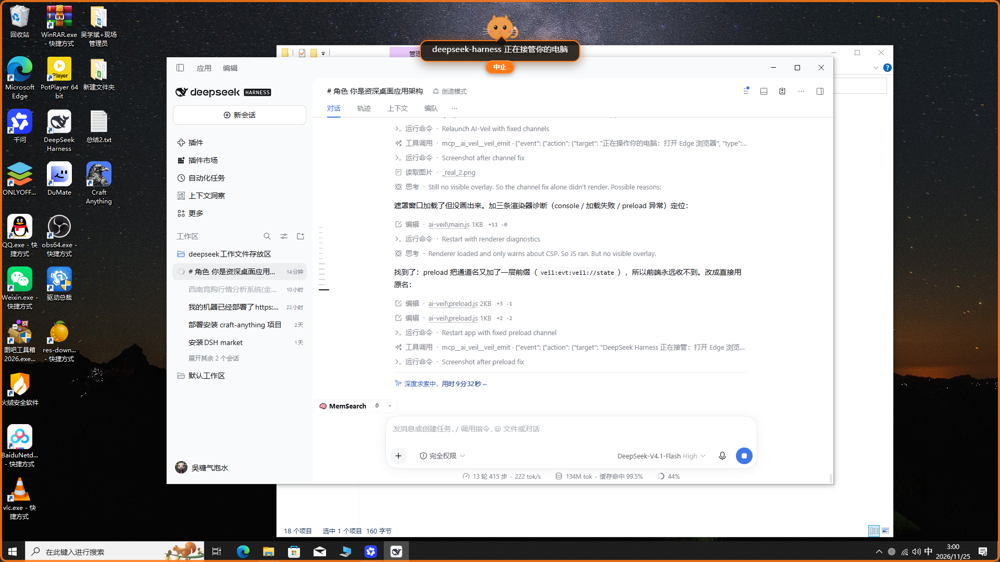
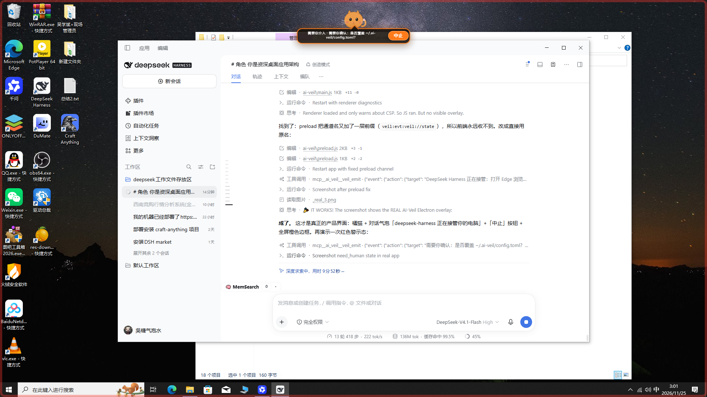

# AI-Veil 接管提示器桥（ai-veil-bridge）

> 一句话价值：装上后，DeepSeek Harness 里的 Agent 每次接管你的鼠标键盘、截图、开应用时，你都会在屏幕上看到系统级横幅与边框、听到提示音、收到桌面通知，并能一键中止——不再是"电脑被悄悄操作"。

`ai-veil-bridge` 是 [AI-Veil](https://github.com/qq2550049106/ai-veil) 桌面端的 **DeepSeek Harness 侧插件**。它本身不画任何东西，只做一件事：把 Agent 的接管动作注册成两个模型可调用的工具，翻译成 AI-Veil 的统一事件，交给桌面端呈现。

## 安装

**方式 A · 桌面版 / 图形界面（推荐，最简单）**

打开 DeepSeek Harness 的 **插件** 页 → **添加插件** → 输入 `ai-veil-bridge`（源码安装可填 `github:qq2550049106/ai-veil-bridge`）→ 安装并启用。

**方式 B · 命令行**

```bash
# 已发布 npm 包时（进「插件中心」一键安装）：
dsh plugin --profile web add ai-veil-bridge

# 仅有 GitHub 源码时（复制命令到终端执行）：
dsh plugin --profile web add github:qq2550049106/ai-veil-bridge
```

把 `web` 换成你宿主实际的 profile 名（桌面版由应用管理 profile，请优先用方式 A）。

装好后，DSH 会话里会多出两个工具：

| 工具 | 作用 |
| --- | --- |
| `veil_emit` | 上报一条接管事件（开始接管、动作前后、需要人工、出错、结束、心跳续期） |
| `veil_cancel` | 请求中止当前接管会话 |

## 让桌面端跑起来

事件写到文件收件箱，桌面端消费它才能看到效果：

```bash
git clone https://github.com/qq2550049106/ai-veil.git
cd ai-veil
npm install
npm start -- --adapter file      # 消费 ~/.ai-veil/events.jsonl
```

首次启动会创建 `~/.ai-veil/`、写入 `config.toml`、播种内置素材，托盘出现灰色圆点。

## 立刻看效果（不接任何 Agent）

```bash
# 终端 A：桌面端
npm start -- --adapter file
# 终端 B：约 10 秒走完"接管 → 动作 → 要确认 → 结束"
node demo/emit-demo.mjs
```

## 它注册了什么

- **零运行时依赖**：只用 Node 内置模块，不额外下载依赖树。
- **宿主集成**：`apply(ctx)` 声明 `inject: ['tools']`，通过 `ctx.tools.register` 注册工具。宿主提供 `@deepseek-ai/dsh-tools` 时借用官方 `defineTool` 做参数校验，否则按同形状的原始定义注册。
- **不写死本机路径**：事件收件箱默认 `~/.ai-veil/events.jsonl`，可用环境变量覆盖，任何机器安装都成立。

## 环境变量

| 变量 | 默认 | 说明 |
| --- | --- | --- |
| `AI_VEIL_INBOX` | `~/.ai-veil/events.jsonl` | 事件落盘路径（插件与桌面端都要一致） |
| `AI_VEIL_CANCEL_DIR` | `~/.ai-veil/cancel` | 中止记录落盘目录 |
| `AI_VEIL_AGENT` | `deepseek-harness` | 事件里 `agent.name` 的默认值 |

## 权限、外部服务与兼容性

- **文件访问**：仅读写 `~/.ai-veil/`（事件收件箱与中止记录）。不读取其他用户文件。
- **网络**：**不联网**。插件只写本地文件，不调用任何外部服务、不收集或上报任何数据。
- **执行命令**：不执行任何 shell 命令。
- **中止边界**：`veil_cancel` 只写一条中止记录并收起遮罩；真正"掐断 Agent 进程"需宿主自身配合。桥是单向上报。
- **兼容性**：要求 DSH `>=0.1.0-rc.6`（Cordis 插件系统、`ctx.tools` 注册接口）。桌面端未启动时事件只会安静排队，DSH 侧不报错、不阻塞。
- **许可证**：MIT。

## 演示截图




## 排错与更多细节

见 [docs/DETAIL.md](docs/DETAIL.md)。

## 自检

```bash
node scripts/self-check.mjs      # 退出码 0 = 通过
```

用最小 fake ctx 加载插件，验证两个工具注册成功、`veil_emit` 能写入合法 JSONL、且包里没有任何本机绝对路径。
